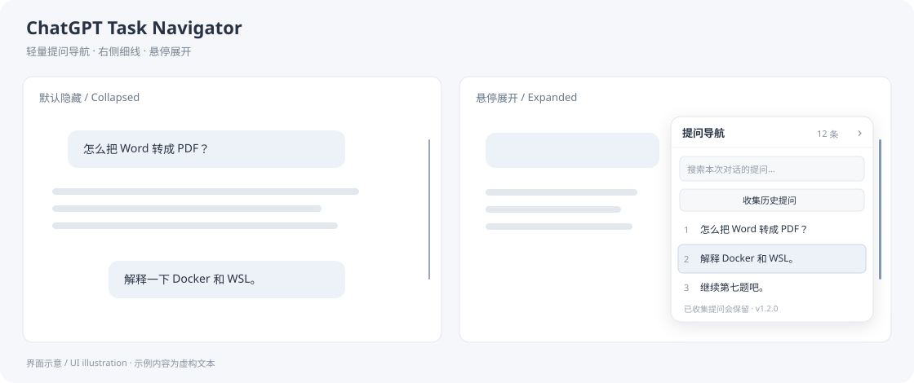

# ChatGPT Task Navigator · 提问导航

[English](README.en.md) · [更新记录](CHANGELOG.md) · [隐私说明](PRIVACY.md) · [贡献指南](CONTRIBUTING.md)

一个轻量的 Chrome 扩展：在 ChatGPT 网页最右侧添加一条细竖线，悬停展开当前对话的提问目录，搜索、预览并跳转到以前的问题。



**版本 1.2.0 · Manifest V3 · 无运行时依赖 · MIT License**

## 功能

- **右侧隐藏导航**：默认只显示约 2px 的竖线，悬停展开，移开自动收起。
- **提问目录**：自动识别用户消息，搜索关键词，悬停或聚焦查看提问原文。
- **点击跳转**：定位消息并短暂高亮；已离屏的消息会尝试重新加载定位。
- **长对话收集**：逐段滚动、等待旧历史加载，将提问保留在当前页面的内存中。
- **正确区分重复提问**：不同消息 ID 的“继续”等相同文字分别保留。
- **轻量界面**：支持浅色／深色主题，键盘聚焦与 Esc 收起。
- **本地处理**：不需要 API Key、不调用模型、不上传聊天、不使用分析服务。

## 安装

目前提供手动安装，**尚未上架 Chrome 应用商店**。

1. 下载本仓库 ZIP 并解压，或从 [Releases](https://github.com/horizon1129/chatgpt-task-navigator/releases) 下载扩展包并解压。
2. 在 Chrome 地址栏打开 `chrome://extensions/`，开启右上角的“开发者模式”。
3. 点击“加载已解压的扩展程序”。
4. **仓库 ZIP：选择其中的 `extension/` 文件夹。发行扩展包：选择解压后直接包含 `manifest.json` 的文件夹。**
5. 打开或刷新 `https://chatgpt.com/` 中的一条聊天。

安装后需要保留扩展文件夹，不要移动或删除。仅安装和使用扩展不需要 Node.js，也不需要运行服务器。

## 使用

将鼠标移到网页**最右侧中部的细线**，目录会向左展开；移开约 0.2 秒后自动隐藏。也可以点击 `›` 或按 Esc 收起。

如果长对话只显示少量问题，点击 **“收集历史提问”**。扫描期间会自动滚动，请先等待；完成后会尝试恢复原来的阅读位置。

- 点“停止收集”，或在正文中滚动、点击、输入，可以中止扫描。
- 收起目录不会丢失已收集的提问；刷新网页后需要重新收集。
- 切换聊天会清空旧目录，防止混入另一条对话。
- 搜索框筛选提问，目录中的编号仍对应原来的提问顺序。

## 支持范围和限制

| 项目 | 状态 |
| --- | --- |
| Chrome 中的 ChatGPT 网页 | 主要目标；无需构建即可手动加载 |
| `chatgpt.com`、`chat.openai.com` | 扩展脚本声明的站点范围 |
| Chrome 之外的 Chromium 浏览器 | 可能可用，尚未逐一测试 |
| 官方 ChatGPT／Codex 桌面客户端 | 不支持直接安装此浏览器扩展 |
| 手机浏览器 | 尚未测试 |

ChatGPT 对长对话使用按需渲染和分页加载。扩展只能收集页面能够加载的消息，**不保证一次读取后台全部历史**；网络缓慢时可以继续收集。单次扫描有约 3 分钟上限，未完成会提示继续。消息重新加载后的跳转是尽力定位，网页布局变化可能影响位置。预览是提问原文，不是 AI 生成的摘要。

ChatGPT 页面结构更新可能使选择器失效。发现问题可提交 [Issue](https://github.com/horizon1129/chatgpt-task-navigator/issues)，请不要附带真实聊天、账户信息或密钥。

## 更新扩展

替换扩展目录中的文件后，在 `chrome://extensions/` 找到“ChatGPT 提问导航”，点击卡片上的 **↻ 重新加载**，再刷新聊天网页。展开目录后可在底部查看版本号。

## 开发与检查

需要 Node.js 22 或更高版本，无需安装 npm 依赖：

```sh
node --run check
node --run test
node --run pack
```

也可使用 `npm run check`、`npm test`、`npm run pack`。扩展包输出到 `dist/chatgpt-task-navigator-v1.2.0.zip`，只包含扩展运行文件和许可证。

```text
extension/          可直接加载的 Chrome 扩展
  manifest.json     扩展入口与站点声明
  content.js        识别消息、历史收集和右侧导航界面
  index-core.js     虚拟列表消息的去重、顺序与保留
tests/              无依赖的 Node.js 回归测试
scripts/            检查和打包脚本
docs/assets/        README 界面示意图
.github/            自动检查、Issue 和 PR 模板
```

自动测试覆盖索引保留、时间顺序、重复提问、编辑更新和聊天重置等状态行为；DOM 兼容和真实账户中的分页加载仍需要人工浏览器验证。参见 [贡献指南](CONTRIBUTING.md)。

## 隐私与许可证

扩展只读取匹配页面中的消息元素，将目录保存在当前页面内存里。没有遥测、外部网络请求、持久化聊天存储或账户凭据读取。详情见 [PRIVACY.md](PRIVACY.md)。

本项目使用 [MIT License](LICENSE)。这是独立的第三方项目，与 OpenAI 无隶属或背书关系。ChatGPT 和 Codex 名称归其各自权利人所有。
